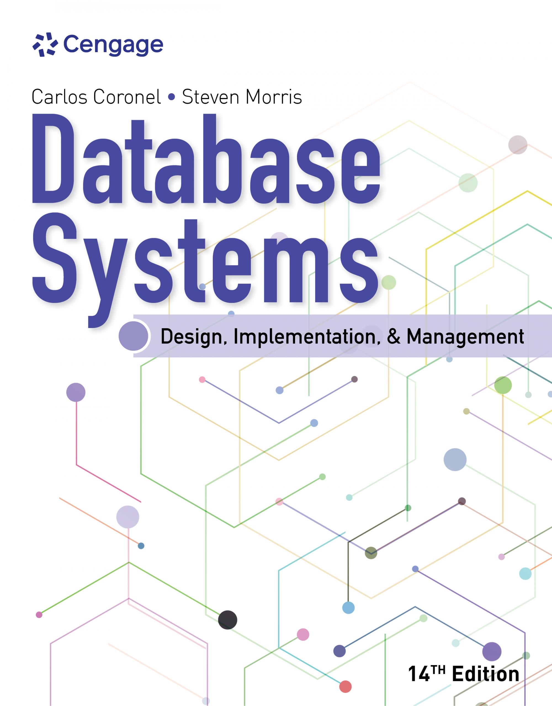
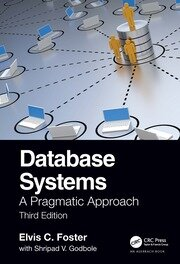

# DBMS

  <button type="button" id="lang-vi" aria-pressed="true">Tiếng Việt</button>
  <button type="button" id="lang-en" aria-pressed="false">English</button>

<section id="content-vi" class="language-panel" lang="vi" markdown="1">

Tài liệu học tập về hệ quản trị cơ sở dữ liệu và MySQL.

## Đề cương môn học

- [Syllabus Database VNUIS](assets/files/Syllabus_Database_VNUIS.pdf)
- Slide giới thiệu môn học & Lộ trình học tập: [VI](lectures/course-intro/course-intro-vn.pdf) / [EN](lectures/course-intro/course-intro-en.pdf)

## Sách tham khảo

| Bìa sách | Tài liệu | Tác giả | Nhà xuất bản | ISBN | Liên kết |
|---|---|---|---|---|---|
|  | **Database Systems: Design, Implementation, & Management, 14th Edition** | Carlos Coronel, Steven Morris | Cengage, 2023 | 9780357673034 | [Thông tin sách](https://www.cengageasia.com/title/default/detail?isbn=9780357673034) |
|  | **Database Systems: A Pragmatic Approach, 3rd edition** | Elvis C. Foster, Shripad Godbole | CRC Press / Taylor & Francis, 2022 | 9781032202020 | [Thông tin sách](https://www.routledge.com/Database-Systems-A-Pragmatic-Approach-3rd-edition/Foster-Godbole/p/book/9781032202020) |

## Introduction

Phần này trình bày các khái niệm nền tảng của DBMS, nhu cầu sử dụng DBMS và các kiến trúc cơ sở dữ liệu thường gặp trong hệ thống thực tế. Trải nghiệm hệ thống học tập có khóa chặng và tự chấm điểm tại [Trung tâm Bài học Tương tác Nhập môn DBMS](lectures/introduction/introduction.html).

| Bài học | Bài giảng Markdown | Bản Web Tương tác (HTML) | Slides PDF | Ghi chú |
|---|---|---|---|---|
| Giới thiệu môn học & Lộ trình học tập | — | — | [VI](lectures/course-intro/course-intro-vn.pdf) / [EN](lectures/course-intro/course-intro-en.pdf) | Lộ trình môn học, chuẩn đầu ra và tổng quan nội dung |
| 🎯 **Trung tâm Bài học Tương tác Nhập môn DBMS (Master Hub)** | — | [HTML Tương tác](lectures/introduction/introduction.html) | — | Hub tổng hợp 4 bài học, theo dõi tiến độ thời gian thực & Cấp chứng nhận |
| 01. Giới thiệu CSDL và Hệ quản trị CSDL (Introduction to DBMS) | [Markdown](lectures/introduction/01-introduction-to-dbms/introduction-to-dbms.md) | [HTML Tương tác](lectures/introduction/01-introduction-to-dbms/introduction-to-dbms.html) | [VI](lectures/introduction/01-introduction-to-dbms/slides/gioi_thieu_csdl_vi_beamer.pdf) / [EN](lectures/introduction/01-introduction-to-dbms/slides/gioi_thieu_csdl_en_beamer.pdf) | Khái niệm CSDL, DBMS, File system vs DBMS, thành phần và ứng dụng |
| 02. Kiến trúc hệ thống DBMS (DBMS System Architecture) | [Markdown](lectures/introduction/02-dbms-system-architecture/dbms-system-architecture.md) | [HTML Tương tác](lectures/introduction/02-dbms-system-architecture/dbms-system-architecture.html) | [VI](lectures/introduction/02-dbms-system-architecture/slides/kien_truc_dbms_vi.pdf) / [EN](lectures/introduction/02-dbms-system-architecture/slides/kien_truc_dbms_en.pdf) | Kiến trúc 1-tier, 2-tier, 3-tier và N-tier |
| 03. Kiến trúc 3 mức ANSI/SPARC: Schema & Độc lập dữ liệu | [Markdown](lectures/introduction/03-three-schema-architecture/three-schema-architecture.md) | [HTML Tương tác](lectures/introduction/03-three-schema-architecture/three-schema-architecture.html) | [VI](lectures/introduction/03-three-schema-architecture/slides/data_independence_beamer_pdflatex.pdf) / [EN](lectures/introduction/03-three-schema-architecture/slides/data_independence_beamer_english_pdflatex.pdf) | Trừu tượng hóa, Schema vs Instance, Độc lập dữ liệu vật lý/logic, Mô hình Schema |
| 04. Cách lựa chọn DBMS phù hợp (Choosing the Right DBMS) | [Markdown](lectures/introduction/04-choosing-the-right-dbms/choose-right-dbms.md) | [HTML Tương tác](lectures/introduction/04-choosing-the-right-dbms/choose-right-dbms.html) | [VI](lectures/introduction/04-choosing-the-right-dbms/slides/choose-right-dbms-vi.pdf) / [EN](lectures/introduction/04-choosing-the-right-dbms/slides/choose-right-dbms-en.pdf) | Phân tích Workload OLTP/OLAP, RDBMS vs NoSQL, Định lý CAP, Cloud |

## Entity Relationship Model

Phần này trình bày mô hình ER ở mức khái niệm, dùng thực thể, thuộc tính và mối quan hệ để biểu diễn dữ liệu trong bài toán thực tế. Trải nghiệm hệ thống học tập có khóa chặng và tự chấm điểm tại [Trung tâm Bài học Tương tác ER & EER Model](lectures/entity-relationship-model/entity-relationship-model.html).

| Bài học | Bài giảng Markdown | Bản Web Tương tác (HTML) | Slides PDF | Ghi chú |
|---|---|---|---|---|
| 🎯 **Trung tâm Bài học Tương tác ER & EER Model (Master Hub)** | — | [HTML Tương tác](lectures/entity-relationship-model/entity-relationship-model.html) | — | Hub tổng hợp 5 bài học, 23 chặng, 46 câu hỏi & Cấp chứng nhận Master |
| 01. Mô hình hóa dữ liệu trong DBMS | [Markdown](lectures/entity-relationship-model/data-modeling/data-modeling.md) | [HTML Tương tác](lectures/entity-relationship-model/data-modeling/data-modeling.html) | — | 3 mức mô hình hóa, so sánh các mô hình logic, SDLC |
| 02. Giới thiệu ER Model trong DBMS | [Markdown](lectures/entity-relationship-model/er-model/er-model.md) | [HTML Tương tác](lectures/entity-relationship-model/er-model/er-model.html) | [VI](lectures/entity-relationship-model/er-model/er-model-vi.pdf) / [EN](lectures/entity-relationship-model/er-model/er-model-en.pdf) | Thực thể mạnh/yếu, thuộc tính, liên kết, bội số, tham gia, ánh xạ SQL |
| 03. Quan hệ đệ quy trong sơ đồ ER | [Markdown](lectures/entity-relationship-model/recursive-relationship/recursive-relationship.md) | [HTML Tương tác](lectures/entity-relationship-model/recursive-relationship/recursive-relationship.html) | — | Quan hệ Unary, Role Names, đệ quy 1:1, 1:N, M:N, Recursive CTE |
| 04. Generalization, Specialization và Aggregation trong ER Model | [Markdown](lectures/entity-relationship-model/generalization-specialization-aggregation/generalization-specialization-aggregation.md) | [HTML Tương tác](lectures/entity-relationship-model/generalization-specialization-aggregation/generalization-specialization-aggregation.html) | — | Bottom-up Generalization, Top-down Specialization, IS-A, Aggregation |
| 05. Mô hình Enhanced ER trong DBMS | [Markdown](lectures/entity-relationship-model/enhanced-er-model/enhanced-er-model.md) | [HTML Tương tác](lectures/entity-relationship-model/enhanced-er-model/enhanced-er-model.html) | [VI](lectures/entity-relationship-model/enhanced-er-model/enhance-er-model-beamer-vi.pdf) | 4 tổ hợp ràng buộc, Category/Union, Đa kế thừa Lattice, Ánh xạ EER |

### Labs ER Model

| Lab | Markdown | PDF | Ghi chú |
|---|---|---|---|
| Lab 1: ER model basics | [Markdown](lectures/entity-relationship-model/lab-er-model-1.md) / [Solution](lectures/entity-relationship-model/lab-er-model-1-hot-water-solution.md) | [Solution PDF](lectures/entity-relationship-model/lab-er-model-1-hot-water-solution.pdf) | Entities, attributes, keys, relationships |
| Lab 2: United Helpers ER model | [Markdown](lectures/entity-relationship-model/lab-er-model-2-united-helpers.md) / [Solution](lectures/entity-relationship-model/lab-er-model-2-united-helpers-solution.md) | [Lab PDF](lectures/entity-relationship-model/lab-er-model-2-united-helpers.pdf) / [Solution PDF](lectures/entity-relationship-model/lab-er-model-2-united-helpers-solution.pdf) | Bài thực hành ER mở rộng |

## Relational Model and Functional Dependencies

Phần này trình bày cách tổ chức dữ liệu theo bảng quan hệ, các loại khóa, phụ thuộc hàm và vai trò của chúng trong thiết kế lược đồ. Trải nghiệm hệ thống học tập có khóa chặng và tự chấm điểm tại [Trung tâm Bài học Tương tác Mô hình Quan hệ & Phụ thuộc Hàm](lectures/relational-model-and-functional-dependencies/relational-model-and-functional-dependencies.html).

| Bài học | Bài giảng Markdown | Bản Web Tương tác (HTML) | Slides PDF | Ghi chú |
|---|---|---|---|---|
| 🎯 **Trung tâm Bài học Tương tác Mô hình Quan hệ & Phụ thuộc Hàm (Master Hub)** | — | [HTML Tương tác](lectures/relational-model-and-functional-dependencies/relational-model-and-functional-dependencies.html) | — | Hub tổng hợp 5 bài học, 25 chặng, 50 câu hỏi & Cấp chứng nhận Master |
| 01. Mô hình Quan hệ & Lược đồ Quan hệ (Relational Schema) | [Markdown](lectures/relational-model-and-functional-dependencies/relational-schema/relational-schema.md) | [HTML Tương tác](lectures/relational-model-and-functional-dependencies/relational-schema/relational-schema.html) | — | Khái niệm Relation, Tuple, Attribute, Schema vs Instance, 4 ràng buộc toàn vẹn |
| 02. Các loại Khóa trong CSDL Quan hệ (Keys in Relational Model) | [Markdown](lectures/relational-model-and-functional-dependencies/key/key.md) | [HTML Tương tác](lectures/relational-model-and-functional-dependencies/key/key.html) | — | Super key, Candidate key, Primary key, Foreign key, Natural vs Surrogate key |
| 03. Ánh xạ từ ER/EER sang Lược đồ Quan hệ (Mapping ER to Relational) | [Markdown](lectures/relational-model-and-functional-dependencies/er-2-relational/er-2-relational.md) | [HTML Tương tác](lectures/relational-model-and-functional-dependencies/er-2-relational/er-2-relational.html) | — | Quy trình 7 bước: thực thể mạnh/yếu, 1:1, 1:N, M:N, đa trị, kế thừa IS-A |
| 04. Phụ thuộc Hàm & Hệ Tiên đề Armstrong (Functional Dependency) | [Markdown](lectures/relational-model-and-functional-dependencies/functional-dependency/functional-dependency.md) | [HTML Tương tác](lectures/relational-model-and-functional-dependencies/functional-dependency/functional-dependency.html) | — | Định nghĩa FD, Tiên đề Armstrong, luật thứ cấp, Bao đóng X+ và tìm Khóa |
| 05. Phân loại Phụ thuộc Hàm & Phủ Tối thiểu (FD Types & Minimal Cover) | [Markdown](lectures/relational-model-and-functional-dependencies/functional-dependency-types/functional-dependency-types.md) | [HTML Tương tác](lectures/relational-model-and-functional-dependencies/functional-dependency-types/functional-dependency-types.html) | — | Trivial, Full vs Partial, Transitive FD, MVD, Phủ tối thiểu, cầu nối chuẩn hóa |

## Normalization

Phần này trình bày chuẩn hóa dữ liệu, các dạng chuẩn và cách giảm dư thừa để cải thiện tính nhất quán của thiết kế cơ sở dữ liệu. Trải nghiệm hệ thống học tập có khóa chặng và tự chấm điểm tại [Trung tâm Bài học Tương tác Chuẩn hóa Dữ liệu (Normalization Hub)](lectures/normalization/normalization.html).

| Bài học | Bài giảng Markdown | Bản Web Tương tác (HTML) | Slides PDF | Ghi chú |
|---|---|---|---|---|
| 🎯 **Trung tâm Bài học Tương tác Chuẩn hóa Dữ liệu (Normalization Master Hub)** | — | [HTML Tương tác](lectures/normalization/normalization.html) | — | Hub tổng hợp 5 bài học, 25 chặng, 50 câu hỏi & Cấp chứng nhận Master |
| 01. Tổng quan Chuẩn hóa & Các Dạng chuẩn (Normal Forms Overview) | [Markdown](lectures/normalization/normal-forms/normal-forms.md) | [HTML Tương tác](lectures/normalization/normal-forms/normal-forms.html) | — | Khái niệm chuẩn hóa, 3 dị thường (Insert/Update/Delete), phân cấp 1NF-5NF, Normalization vs Denormalization |
| 02. Dạng chuẩn 1 - First Normal Form (1NF) | [Markdown](lectures/normalization/1st-normal-form/1st-normal-form.md) | [HTML Tương tác](lectures/normalization/1st-normal-form/1st-normal-form.html) | — | Tính nguyên tử (Atomic values), loại bỏ nhóm lặp, mảng/danh sách trong ô và kỹ thuật phân tách bảng |
| 03. Dạng chuẩn 2 - Second Normal Form (2NF) | [Markdown](lectures/normalization/2nd-normal-form/2nd-normal-form.md) | [HTML Tương tác](lectures/normalization/2nd-normal-form/2nd-normal-form.html) | — | Phụ thuộc đầy đủ vào khóa chính, triệt tiêu phụ thuộc hàm một phần (Partial FD) trên khóa ghép |
| 04. Dạng chuẩn 3 & Boyce-Codd (3NF & BCNF) | [Markdown](lectures/normalization/3rd-normal-form/3rd-normal-form.md) | [HTML Tương tác](lectures/normalization/3rd-normal-form/3rd-normal-form.html) | — | Triệt tiêu phụ thuộc bắc cầu (Transitive FD), điều kiện Super Key vs Prime Attribute, phân rã BCNF |
| 05. Dạng chuẩn 4 & Dạng chuẩn 5 (4NF & 5NF) | [Markdown](lectures/normalization/4th-normal-form/4th-normal-form.md) | [HTML Tương tác](lectures/normalization/4th-normal-form/4th-normal-form.html) | — | Phụ thuộc đa trị (MVD), triệt tiêu tích Đề-các trong 4NF, phụ thuộc nối (Join Dependency) & 5NF |

## MySQL Server

Phần này trình bày kiến trúc phân tầng, cài đặt, kết nối, cấu hình và quản trị vòng đời dịch vụ MySQL Server trước khi làm việc với SQL. Trải nghiệm hệ thống học tập có khóa chặng và tự chấm điểm tại [Trung tâm Bài học Tương tác MySQL Server (MySQL Server Hub)](lectures/MySQL/mysql-server/mysql-server.html).

| Bài học | Bài giảng Markdown | Bản Web Tương tác (HTML) | Slides PDF | Ghi chú |
|---|---|---|---|---|
| 🎯 **Trung tâm Bài học Tương tác MySQL Server (MySQL Server Master Hub)** | — | [HTML Tương tác](lectures/MySQL/mysql-server/mysql-server.html) | — | Hub tổng hợp 5 bài học, 25 chặng, 50 câu hỏi & Cấp chứng nhận Master |
| 01. Tổng quan & Kiến trúc MySQL Server (Overview & Architecture) | [Markdown](lectures/MySQL/mysql-server/gioi-thieu-mysql/gioi-thieu-mysql.md) | [HTML Tương tác](lectures/MySQL/mysql-server/gioi-thieu-mysql/gioi-thieu-mysql.html) | [PDF](lectures/MySQL/mysql-server/gioi-thieu-mysql/gioi-thieu-mysql.pdf) | RDBMS, mô hình Client-Server, 3 tầng kiến trúc, vai trò daemon mysqld và InnoDB Buffer Pool |
| 02. Cài đặt, Công cụ Phát triển & Kết nối MySQL (Installation & Tools) | [Markdown](lectures/MySQL/mysql-server/installation-and-connection/installation-and-connection.md) | [HTML Tương tác](lectures/MySQL/mysql-server/installation-and-connection/installation-and-connection.html) | — | Cài đặt Windows Installer, MySQL Workbench GUI, kết nối CLI client, tích hợp VS Code và xử lý lỗi kết nối |
| 03. Vòng đời Server & Quản lý Dịch vụ (Server Lifecycle & Service) | [Markdown](lectures/MySQL/mysql-server/start-stop-MySQL/start-stop-MySQL.md) | [HTML Tương tác](lectures/MySQL/mysql-server/start-stop-MySQL/start-stop-MySQL.html) | — | Start, Stop, Restart trên Windows/Linux, cơ chế Graceful Shutdown, flush dirty pages và đọc Error Log |
| 04. Cấu hình Hệ thống & Thư mục Dữ liệu (Configuration & Data Directory) | [Markdown](lectures/MySQL/mysql-server/configuration-and-datadir/configuration-and-datadir.md) | [HTML Tương tác](lectures/MySQL/mysql-server/configuration-and-datadir/configuration-and-datadir.html) | — | File my.ini/my.cnf, thứ tự ưu tiên, Option Groups, Biến động/tĩnh, thư mục datadir, Redo & Undo Log |
| 05. MySQL Storage Engines & CSDL Mẫu classicmodels (Storage & Sample DB) | [Markdown](lectures/MySQL/mysql-server/storage-engine/storage-engine.md) | [HTML Tương tác](lectures/MySQL/mysql-server/storage-engine/storage-engine.html) | [VI](lectures/MySQL/mysql-server/storage-engine/mysql_storage_engines.pdf) / [EN](lectures/MySQL/mysql-server/storage-engine/mysql_storage_engines_en.pdf) | Pluggable Storage Engine, InnoDB ACID vs MyISAM/Memory, mô hình 8 bảng classicmodels và lệnh SOURCE |

## Quản lý CSDL và quản trị MySQL

Phần này trình bày các thao tác quản trị cơ sở dữ liệu và quản trị dịch vụ MySQL: quản lý vòng đời CSDL, khám phá siêu dữ liệu với `SHOW`, giám sát tiến trình và backup/restore với `mysqldump`, phân quyền & RBAC Roles, cùng các kỹ thuật an toàn dữ liệu và mã hóa đối xứng. Trải nghiệm hệ thống học tập có khóa chặng và tự chấm điểm tại [Trung tâm Bài học Tương tác Quản trị CSDL MySQL (DBA Master Hub)](lectures/MySQL/database-administration/database-administration.html).

| Bài học | Bài giảng Markdown | Bản Web Tương tác (HTML) | Slides PDF | Ghi chú |
|---|---|---|---|---|
| 🎯 **Trung tâm Bài học Tương tác Quản trị CSDL MySQL (DBA Master Hub)** | — | [HTML Tương tác](lectures/MySQL/database-administration/database-administration.html) | — | Hub tổng hợp 5 bài học, 25 chặng, 50 câu hỏi & Cấp chứng nhận Master DBA |
| 01. Quản lý Vòng đời Database trong MySQL | [Markdown](lectures/MySQL/database-administration/database/create-use-drop-database.md) | [Lý thuyết](lectures/MySQL/database-administration/database/create-use-drop-database.html) / [Bài tập SQL](lectures/MySQL/database-administration/database/database-lifecycle-sql-lab.html) | — | `CREATE DATABASE`, `USE`, `DROP DATABASE`, Charset utf8mb4, Collation và Checklist an toàn Production |
| 02. Lệnh SHOW & Khám phá Siêu dữ liệu trong MySQL | [Markdown](lectures/MySQL/database-administration/show-command/show-command.md) | [Lý thuyết](lectures/MySQL/database-administration/show-command/show-command.html) / [Bài tập SQL](lectures/MySQL/database-administration/show-command/show-command-sql-lab.html) | — | `SHOW DATABASES/TABLES/COLUMNS/STATUS/VARIABLES`, LIKE pattern, information_schema và performance_schema |
| 03. Giám sát Tiến trình & Sao lưu Phục hồi CSDL MySQL | [Markdown](lectures/MySQL/database-administration/backup-and-recovery/backup-and-recovery.md) | [Lý thuyết](lectures/MySQL/database-administration/backup-and-recovery/backup-and-recovery.html) / [Bài tập SQL](lectures/MySQL/database-administration/backup-and-recovery/backup-recovery-sql-lab.html) | — | `SHOW PROCESSLIST`, `KILL query/connection`, mysqldump sao lưu logic, single-transaction, phục hồi qua CLI |
| 04. Quản lý Người dùng, Phân quyền & Role trong MySQL | [Markdown](lectures/MySQL/database-administration/user-administration/user-administration.md) | [Lý thuyết](lectures/MySQL/database-administration/user-administration/user-administration.html) / [Bài tập SQL](lectures/MySQL/database-administration/user-administration/user-administration-sql-lab.html) | — | Định danh Host `@'%'` vs `@'localhost'`, `CREATE USER`, `GRANT/REVOKE`, `mysql.user`, RBAC Roles và Nguyên tắc đặc quyền tối thiểu |
| 05. An toàn Dữ liệu & Các hàm Mã hóa trong MySQL | [Markdown](lectures/MySQL/database-administration/security/encryption-decryption.md) | [Lý thuyết](lectures/MySQL/database-administration/security/encryption-decryption.html) / [Bài tập SQL](lectures/MySQL/database-administration/security/security-encryption-sql-lab.html) | — | Base64 Encoding vs Hash 1 chiều (SHA2/MD5), Mã hóa đối xứng AES-256 (`AES_ENCRYPT/DECRYPT`), Quản lý khóa & TDE |

## Câu lệnh SQL trong MySQL

Phần này trình bày các câu lệnh SQL theo từng loại công việc: định nghĩa cấu trúc dữ liệu, truy vấn, tối ưu, thay đổi dữ liệu/giao dịch và lập trình trong database. Trình tự nội dung đi từ thao tác bảng cơ bản đến các đối tượng nâng cao như view, procedure, trigger và event.

### Định nghĩa dữ liệu và kiểu dữ liệu

Phần DDL trình bày kiểu dữ liệu, tạo bảng, ràng buộc và vòng đời table trong MySQL.

| Bài học | Bài giảng Markdown | Bản Web (HTML) | Slides PDF | Ghi chú |
|---|---|---|---|---|
| Kiểu dữ liệu SQL | [Markdown](lectures/MySQL/data-definition/sql-data-types/sql-data-types.md) | [HTML](lectures/MySQL/data-definition/sql-data-types/sql-data-types.html) | [PDF](lectures/MySQL/data-definition/sql-data-types/sql-data-types.pdf) | Numeric, string, date/time và chọn kiểu dữ liệu |
| CREATE TABLE và ràng buộc trong MySQL | [Markdown](lectures/MySQL/data-definition/create-table-statement.md) | [HTML](lectures/MySQL/data-definition/create-table-statement.html) | [PDF](lectures/MySQL/data-definition/create-table-statement.pdf) | PRIMARY KEY, FOREIGN KEY, NOT NULL, UNIQUE, CHECK và DEFAULT |
| Quản lý vòng đời Table trong MySQL | [Markdown](lectures/MySQL/data-definition/table/tables.md) | [HTML](lectures/MySQL/data-definition/table/tables.html) | [PDF](lectures/MySQL/data-definition/table/tables.pdf) | CREATE, ALTER, RENAME, DROP, temporary table, TRUNCATE và generated columns |

### Truy vấn dữ liệu với SELECT

Phần truy vấn trình bày `SELECT` cơ bản, JOIN, aggregate, subquery, CTE, set operations và window functions trên CSDL mẫu `classicmodels`.

| Bài học | Bài giảng Markdown | Bản Web (HTML) | Slides PDF | Ghi chú |
|---|---|---|---|---|
| Câu lệnh SELECT cơ bản trong MySQL | [Markdown](lectures/MySQL/querying-data/select/select-statement-1.md) | [HTML](lectures/MySQL/querying-data/select/sql_select_interactive_v8_fixed_schema_commands.html) | [PDF](lectures/MySQL/querying-data/select/sql-select-slide-vn-1.pdf) | Sử dụng CSDL mẫu `classicmodels` |
| SELECT và JOIN trong MySQL | [Markdown](lectures/MySQL/querying-data/select/select-statement-2.md) | [HTML](lectures/MySQL/querying-data/select/sql_select_join_interactive_quiz_v4.html) | [PDF](lectures/MySQL/querying-data/select/select_statement_2_beamer.pdf) | Sử dụng CSDL mẫu `classicmodels` |
| Hàm SQL trong MySQL | [Markdown](lectures/MySQL/querying-data/select/select-statement-3.md) | [HTML](lectures/MySQL/querying-data/select/sql_select_statement_3_interactive_lab.html) | — | Sử dụng CSDL mẫu `classicmodels` |
| GROUP BY, HAVING và truy vấn tổng hợp trong MySQL | [Markdown](lectures/MySQL/querying-data/select/select-statement-4.md) | [HTML](lectures/MySQL/querying-data/select/sql_select_statement_4_interactive_lab.html) | — | Sử dụng CSDL mẫu `classicmodels` |
| Subquery trong MySQL | [Markdown](lectures/MySQL/querying-data/select/select-statement-5.md) | [HTML](lectures/MySQL/querying-data/select/sql_select_statement_5_interactive_lab_v2_columns.html) | [PDF](lectures/MySQL/querying-data/select/dbms_select_5_subqueries_beamer.pdf) | Sử dụng CSDL mẫu `classicmodels` |
| CTE và WITH trong MySQL | [Markdown](lectures/MySQL/querying-data/select/select-statement-6.md) | [HTML](lectures/MySQL/querying-data/select/sql_select_statement_6_interactive_lab_v2_columns.html) | [PDF](lectures/MySQL/querying-data/select/dbms_select_6_cte_beamer.pdf) | Sử dụng CSDL mẫu `classicmodels` |
| Subquery với EXISTS, NOT EXISTS, ALL và ANY trong MySQL | [Markdown](lectures/MySQL/querying-data/select/select-statement-7.md) | [HTML](lectures/MySQL/querying-data/select/sql_select_statement_7_interactive_lab_v2.html) | — | Sử dụng CSDL mẫu `classicmodels` |
| Các phép toán tập hợp UNION, EXCEPT và INTERSECT trong MySQL | [Markdown](lectures/MySQL/querying-data/set-operations.md) | [HTML](lectures/MySQL/querying-data/set-operations-interactive-lab.html) | — | Sử dụng CSDL mẫu `classicmodels` |
| Window Functions trong MySQL | [Markdown](lectures/MySQL/querying-data/window-functions/window-functions.md) | [HTML](lectures/MySQL/querying-data/select/sql_window_functions_interactive_lab.html) | — | ROW_NUMBER, RANK, frame và partition |
| Lab: Kết nối nhiều bảng bằng WHERE và JOIN ON trong MySQL | [Markdown](lectures/MySQL/querying-data/select/select-statement-note-1.md) | — | — | Ghi chú bổ sung về implicit join, explicit join và điều kiện `ON` |
| Tutorial: CTE vs Subquery trong MySQL | [Markdown](lectures/MySQL/querying-data/select/select-statement-note-2.md) | — | — | Ghi chú bổ sung so sánh Subquery và CTE |

### Index và tối ưu truy vấn

Phần này trình bày cách MySQL sử dụng index, cách tạo/xóa index, đọc thông tin index và sử dụng index hints khi cần định hướng optimizer.

| Bài học | Bài giảng Markdown | Bản Web (HTML) | Slides PDF | Ghi chú |
|---|---|---|---|---|
| Tạo và quản lý Index trong MySQL | [Markdown](lectures/MySQL/index-optimization/index/index-1.md) | [HTML](lectures/MySQL/index-optimization/index/dbms_index_1_interactive_lab.html) | [PDF](lectures/MySQL/index-optimization/index/dbms_index_1_beamer.pdf) | CREATE INDEX, DROP INDEX, SHOW INDEX và composite index |
| MySQL Index Types và chiến lược chọn Index | [Markdown](lectures/MySQL/index-optimization/index/index-2.md) | [HTML](lectures/MySQL/index-optimization/index/dbms_index_2_interactive_lab.html) | [PDF](lectures/MySQL/index-optimization/index/dbms_index_2_beamer.pdf) | Unique, prefix, invisible, descending, clustered và functional indexes |
| MySQL Index Hints: USE INDEX và FORCE INDEX | [Markdown](lectures/MySQL/index-optimization/index/index-3.md) | [HTML](lectures/MySQL/index-optimization/index/dbms_index_3_interactive_lab.html) | [PDF](lectures/MySQL/index-optimization/index/dbms_index_3_beamer.pdf) | EXPLAIN, optimizer và index hints |

### Thao tác dữ liệu và giao dịch

Phần DML và transaction trình bày thao tác thay đổi dữ liệu, kiểm soát commit/rollback, savepoint, locking và các tình huống đồng thời trong MySQL.

| Bài học | Bài giảng Markdown | Bản Web (HTML) | Slides PDF | Ghi chú |
|---|---|---|---|---|
| INSERT, UPDATE, DELETE và thao tác dữ liệu nâng cao trong MySQL | [Markdown](lectures/MySQL/data-modification-transactions/modifying-data.md) | — | — | INSERT, UPDATE, DELETE, CASCADE, DELETE JOIN và REPLACE |
| Transaction trong MySQL | [Markdown](lectures/MySQL/data-modification-transactions/transaction.md) | — | — | START TRANSACTION, COMMIT, ROLLBACK, SAVEPOINT và autocommit |
| MySQL Table Locking và InnoDB Locks | [Markdown](lectures/MySQL/data-modification-transactions/locking/locking.md) | — | — | LOCK TABLES, READ/WRITE locks, row locks, metadata locks và deadlocks |

### View, stored procedure, stored function, trigger và event

Phần programmability trình bày các đối tượng dùng để đóng gói logic trong database: view, stored procedure, stored function, trigger và event scheduler.

| Bài học | Bài giảng Markdown | Bản Web (HTML) | Slides PDF | Ghi chú |
|---|---|---|---|---|
| Views trong MySQL | [Markdown](lectures/MySQL/programmability/view/view.md) | — | [PDF](lectures/MySQL/programmability/view/view.pdf) | CREATE VIEW, updatable view và WITH CHECK OPTION |
| Stored Procedures cơ bản trong MySQL | [Markdown](lectures/MySQL/programmability/stored-procedure/stored-procedure-1.md) | — | — | DELIMITER, CREATE PROCEDURE, CALL và tham số |
| Điều kiện và vòng lặp trong MySQL Stored Procedures | [Markdown](lectures/MySQL/programmability/stored-procedure/stored-procedure-2.md) | — | — | IF, CASE, LOOP, WHILE, REPEAT và LEAVE |
| Cursors và Prepared Statements trong MySQL Stored Procedures | [Markdown](lectures/MySQL/programmability/stored-procedure/stored-procedure-3.md) | — | — | Cursor và dynamic SQL |
| Stored Functions trong MySQL | [Markdown](lectures/MySQL/programmability/stored-procedure/stored-procedure-4.md) | — | — | CREATE FUNCTION, DROP FUNCTION và SHOW FUNCTION STATUS |
| MySQL Triggers: nền tảng, CREATE/DROP/SHOW và INSERT triggers | [Markdown](lectures/MySQL/programmability/trigger/triggers-1.md) | — | — | BEFORE INSERT, AFTER INSERT, audit log và summary table |
| MySQL Triggers: UPDATE, DELETE, validation và audit | [Markdown](lectures/MySQL/programmability/trigger/triggers-2.md) | — | — | BEFORE UPDATE, AFTER UPDATE, BEFORE DELETE và AFTER DELETE |
| MySQL Triggers: multiple triggers, metadata và best practices | [Markdown](lectures/MySQL/programmability/trigger/triggers-3.md) | — | — | PRECEDES, FOLLOWS, INFORMATION_SCHEMA và restrictions |
| MySQL Events và Event Scheduler | [Markdown](lectures/MySQL/programmability/events/event.md) | — | — | CREATE EVENT, ALTER EVENT, SHOW EVENTS và DROP EVENT |

## Tham khảo

- GeeksforGeeks: [Database Management System Tutorial](https://www.geeksforgeeks.org/dbms/dbms/)
- GeeksforGeeks: [SQL Tutorial](https://www.geeksforgeeks.org/sql/sql-tutorial/)
- MySQL Tutorial: [MySQL Tutorial](https://www.mysqltutorial.org/)
- GeeksforGeeks: [30 Days of SQL - From Basic to Advanced Level](https://www.geeksforgeeks.org/sql/30-days-of-sql-from-basic-to-advanced-level/)
- Roadmap.sh: [SQL Roadmap](https://roadmap.sh/sql?fl=1)

</section>

<section id="content-en" class="language-panel" lang="en" hidden markdown="1">

Learning materials for database management systems and MySQL.

## Course Syllabus

- [Syllabus Database VNUIS](assets/files/Syllabus_Database_VNUIS.pdf)
- Course Introduction Slides: [VI](lectures/course-intro/course-intro-vn.pdf) / [EN](lectures/course-intro/course-intro-en.pdf)

## Reference Books

| Cover | Reference | Authors | Publisher | ISBN | Link |
|---|---|---|---|---|---|
|  | **Database Systems: Design, Implementation, & Management, 14th Edition** | Carlos Coronel, Steven Morris | Cengage, 2023 | 9780357673034 | [Book information](https://www.cengageasia.com/title/default/detail?isbn=9780357673034) |
|  | **Database Systems: A Pragmatic Approach, 3rd edition** | Elvis C. Foster, Shripad Godbole | CRC Press / Taylor & Francis, 2022 | 9781032202020 | [Book information](https://www.routledge.com/Database-Systems-A-Pragmatic-Approach-3rd-edition/Foster-Godbole/p/book/9781032202020) |

## Introduction

This section introduces the foundational concepts of DBMS, the rationale for database management systems, and common database architectures in real-world systems. Stage-locked interactive learning system with auto-grading is available at the [Introduction to DBMS Interactive Learning Hub](lectures/introduction/introduction.html).

| Lesson | Markdown Lecture | Interactive Web (HTML) | Slides PDF | Notes |
|---|---|---|---|---|
| Course Introduction: Roadmap & Learning Overview | — | — | [VI](lectures/course-intro/course-intro-vn.pdf) / [EN](lectures/course-intro/course-intro-en.pdf) | Course roadmap, learning objectives, and overview |
| 🎯 **Introduction to DBMS Interactive Learning Center (Master Hub)** | — | [Interactive HTML](lectures/introduction/introduction.html) | — | Aggregated 4 lessons, real-time progress tracking & Master certificate |
| 01. Introduction to DBMS: Database & DBMS | [Markdown](lectures/introduction/01-introduction-to-dbms/introduction-to-dbms.md) | [Interactive HTML](lectures/introduction/01-introduction-to-dbms/introduction-to-dbms.html) | [VI](lectures/introduction/01-introduction-to-dbms/slides/gioi_thieu_csdl_vi_beamer.pdf) / [EN](lectures/introduction/01-introduction-to-dbms/slides/gioi_thieu_csdl_en_beamer.pdf) | Core concepts, File system vs DBMS, components, and real-world applications |
| 02. DBMS System Architecture | [Markdown](lectures/introduction/02-dbms-system-architecture/dbms-system-architecture.md) | [Interactive HTML](lectures/introduction/02-dbms-system-architecture/dbms-system-architecture.html) | [VI](lectures/introduction/02-dbms-system-architecture/slides/kien_truc_dbms_vi.pdf) / [EN](lectures/introduction/02-dbms-system-architecture/slides/kien_truc_dbms_en.pdf) | 1-tier, 2-tier, 3-tier, and multi-tier architectures |
| 03. Three-Schema Architecture, Schemas & Data Independence | [Markdown](lectures/introduction/03-three-schema-architecture/three-schema-architecture.md) | [Interactive HTML](lectures/introduction/03-three-schema-architecture/three-schema-architecture.html) | [VI](lectures/introduction/03-three-schema-architecture/slides/data_independence_beamer_pdflatex.pdf) / [EN](lectures/introduction/03-three-schema-architecture/slides/data_independence_beamer_english_pdflatex.pdf) | ANSI/SPARC 3 levels, Schema vs Instance, Physical/Logical Independence, Schema Models |
| 04. Choosing the Right DBMS | [Markdown](lectures/introduction/04-choosing-the-right-dbms/choose-right-dbms.md) | [Interactive HTML](lectures/introduction/04-choosing-the-right-dbms/choose-right-dbms.html) | [VI](lectures/introduction/04-choosing-the-right-dbms/slides/choose-right-dbms-vi.pdf) / [EN](lectures/introduction/04-choosing-the-right-dbms/slides/choose-right-dbms-en.pdf) | Workload analysis (OLTP/OLAP), RDBMS vs NoSQL, CAP theorem, and Cloud deployment |

## Entity Relationship Model

This section covers the conceptual ER model, using entities, attributes, and relationships to model real-world business data. Interactive stage-by-stage learning available at [ER & EER Interactive Learning Hub](lectures/entity-relationship-model/entity-relationship-model.html).

| Lesson | Markdown Lecture | Interactive Web (HTML) | Slides PDF | Notes |
|---|---|---|---|---|
| 🎯 **ER & EER Interactive Learning Center (Master Hub)** | — | [Interactive HTML](lectures/entity-relationship-model/entity-relationship-model.html) | — | Aggregated 5 lessons, 23 stages, 46 questions & Master certificate |
| 01. Data Modeling in DBMS | [Markdown](lectures/entity-relationship-model/data-modeling/data-modeling.md) | [Interactive HTML](lectures/entity-relationship-model/data-modeling/data-modeling.html) | — | 3 modeling levels, logical models comparison, SDLC |
| 02. Introduction to ER Model in DBMS | [Markdown](lectures/entity-relationship-model/er-model/er-model.md) | [Interactive HTML](lectures/entity-relationship-model/er-model/er-model.html) | [VI](lectures/entity-relationship-model/er-model/er-model-vi.pdf) / [EN](lectures/entity-relationship-model/er-model/er-model-en.pdf) | Strong/weak entities, attributes, relationships, cardinalities, SQL mapping |
| 03. Recursive Relationships in ER Diagrams | [Markdown](lectures/entity-relationship-model/recursive-relationship/recursive-relationship.md) | [Interactive HTML](lectures/entity-relationship-model/recursive-relationship/recursive-relationship.html) | — | Unary relationships, Role Names, 1:1, 1:N, M:N, Recursive CTE |
| 04. Generalization, Specialization, and Aggregation in the ER Model | [Markdown](lectures/entity-relationship-model/generalization-specialization-aggregation/generalization-specialization-aggregation.md) | [Interactive HTML](lectures/entity-relationship-model/generalization-specialization-aggregation/generalization-specialization-aggregation.html) | — | Bottom-up Generalization, Top-down Specialization, IS-A, Aggregation |
| 05. Enhanced ER Model in DBMS | [Markdown](lectures/entity-relationship-model/enhanced-er-model/enhanced-er-model.md) | [Interactive HTML](lectures/entity-relationship-model/enhanced-er-model/enhanced-er-model.html) | [VI](lectures/entity-relationship-model/enhanced-er-model/enhance-er-model-beamer-vi.pdf) | 4 constraint combinations, Category/Union, Lattice, EER mapping |

### ER Model Labs

| Lab | Markdown | PDF | Notes |
|---|---|---|---|
| Lab 1: ER model basics | [Markdown](lectures/entity-relationship-model/lab-er-model-1.md) / [Solution](lectures/entity-relationship-model/lab-er-model-1-hot-water-solution.md) | [Solution PDF](lectures/entity-relationship-model/lab-er-model-1-hot-water-solution.pdf) | Entities, attributes, keys, relationships |
| Lab 2: United Helpers ER model | [Markdown](lectures/entity-relationship-model/lab-er-model-2-united-helpers.md) / [Solution](lectures/entity-relationship-model/lab-er-model-2-united-helpers-solution.md) | [Lab PDF](lectures/entity-relationship-model/lab-er-model-2-united-helpers.pdf) / [Solution PDF](lectures/entity-relationship-model/lab-er-model-2-united-helpers-solution.pdf) | Extended ER practice |

## Relational Model and Functional Dependencies

This section covers data organization in relational tables, key types, functional dependencies, and their role in relational schema design. Stage-locked interactive learning system with auto-grading is available at the [Relational Model & Functional Dependencies Interactive Learning Hub](lectures/relational-model-and-functional-dependencies/relational-model-and-functional-dependencies.html).

| Lesson | Markdown Lecture | Interactive Web (HTML) | Slides PDF | Notes |
|---|---|---|---|---|
| 🎯 **Relational Model & Functional Dependencies Interactive Learning Center (Master Hub)** | — | [Interactive HTML](lectures/relational-model-and-functional-dependencies/relational-model-and-functional-dependencies.html) | — | Aggregated 5 lessons, 25 stages, 50 questions & Master certificate |
| 01. Relational Model & Relational Schema | [Markdown](lectures/relational-model-and-functional-dependencies/relational-schema/relational-schema.md) | [Interactive HTML](lectures/relational-model-and-functional-dependencies/relational-schema/relational-schema.html) | — | Relations, Tuples, Attributes, Schema vs Instance, 4 core integrity constraints |
| 02. Types of Keys in the Relational Model | [Markdown](lectures/relational-model-and-functional-dependencies/key/key.md) | [Interactive HTML](lectures/relational-model-and-functional-dependencies/key/key.html) | — | Super keys, candidate keys, primary keys, foreign keys, natural vs surrogate keys |
| 03. Mapping ER/EER to Relational Schema | [Markdown](lectures/relational-model-and-functional-dependencies/er-2-relational/er-2-relational.md) | [Interactive HTML](lectures/relational-model-and-functional-dependencies/er-2-relational/er-2-relational.html) | — | 7-step mapping: strong/weak entities, 1:1, 1:N, M:N, multivalued, IS-A inheritance |
| 04. Functional Dependency & Armstrong's Axioms | [Markdown](lectures/relational-model-and-functional-dependencies/functional-dependency/functional-dependency.md) | [Interactive HTML](lectures/relational-model-and-functional-dependencies/functional-dependency/functional-dependency.html) | — | Formal FD definition, Armstrong's axioms, secondary rules, attribute closure X+, candidate keys |
| 05. FD Types & Minimal Cover | [Markdown](lectures/relational-model-and-functional-dependencies/functional-dependency-types/functional-dependency-types.md) | [Interactive HTML](lectures/relational-model-and-functional-dependencies/functional-dependency-types/functional-dependency-types.html) | — | Trivial, full vs partial, transitive FD, MVD, minimal cover algorithm, normalization bridge |

## Normalization

This section covers database normalization, normal forms, and redundancy reduction strategies to improve relational database consistency and integrity. Stage-locked interactive learning system with auto-grading is available at the [Database Normalization Interactive Learning Hub](lectures/normalization/normalization.html).

| Lesson | Markdown Lecture | Interactive Web (HTML) | Slides PDF | Notes |
|---|---|---|---|---|
| 🎯 **Database Normalization Interactive Learning Center (Master Hub)** | — | [Interactive HTML](lectures/normalization/normalization.html) | — | Aggregated 5 lessons, 25 stages, 50 questions & Master certificate |
| 01. Normal Forms Overview in DBMS | [Markdown](lectures/normalization/normal-forms/normal-forms.md) | [Interactive HTML](lectures/normalization/normal-forms/normal-forms.html) | — | Normalization concepts, 3 anomalies (Insert/Update/Delete), 1NF-5NF hierarchy, Normalization vs Denormalization |
| 02. First Normal Form (1NF) in DBMS | [Markdown](lectures/normalization/1st-normal-form/1st-normal-form.md) | [Interactive HTML](lectures/normalization/1st-normal-form/1st-normal-form.html) | — | Atomic values, removing repeating groups and array/list values, decomposition techniques |
| 03. Second Normal Form (2NF) in DBMS | [Markdown](lectures/normalization/2nd-normal-form/2nd-normal-form.md) | [Interactive HTML](lectures/normalization/2nd-normal-form/2nd-normal-form.html) | — | Full functional dependency on primary key, eliminating partial dependencies on composite keys |
| 04. Third Normal Form & Boyce-Codd (3NF & BCNF) | [Markdown](lectures/normalization/3rd-normal-form/3rd-normal-form.md) | [Interactive HTML](lectures/normalization/3rd-normal-form/3rd-normal-form.html) | — | Eliminating transitive dependencies, Super Key vs Prime Attribute conditions, BCNF decomposition |
| 05. Fourth & Fifth Normal Forms (4NF & 5NF) | [Markdown](lectures/normalization/4th-normal-form/4th-normal-form.md) | [Interactive HTML](lectures/normalization/4th-normal-form/4th-normal-form.html) | — | Multivalued dependencies (MVD), eliminating Cartesian product redundancy in 4NF, Join Dependency & 5NF |

## MySQL Server

This section covers MySQL Server architecture, installation, client connections, service lifecycle, configuration files, and storage engines. Stage-locked interactive learning system with auto-grading is available at the [MySQL Server Interactive Learning Hub](lectures/MySQL/mysql-server/mysql-server.html).

| Lesson | Markdown Lecture | Interactive Web (HTML) | Slides PDF | Notes |
|---|---|---|---|---|
| 🎯 **MySQL Server Interactive Learning Center (Master Hub)** | — | [Interactive HTML](lectures/MySQL/mysql-server/mysql-server.html) | — | Aggregated 5 lessons, 25 stages, 50 questions & Master certificate |
| 01. Overview & MySQL Server Architecture | [Markdown](lectures/MySQL/mysql-server/gioi-thieu-mysql/gioi-thieu-mysql.md) | [Interactive HTML](lectures/MySQL/mysql-server/gioi-thieu-mysql/gioi-thieu-mysql.html) | [PDF](lectures/MySQL/mysql-server/gioi-thieu-mysql/gioi-thieu-mysql.pdf) | RDBMS concepts, Client-Server model, 3 architectural layers, mysqld daemon, and Buffer Pool |
| 02. Installation, Development Tools & Client Connections | [Markdown](lectures/MySQL/mysql-server/installation-and-connection/installation-and-connection.md) | [Interactive HTML](lectures/MySQL/mysql-server/installation-and-connection/installation-and-connection.html) | — | Windows Installer setup, MySQL Workbench GUI, CLI client connection, VS Code extension, and error troubleshooting |
| 03. Server Lifecycle & Service Management | [Markdown](lectures/MySQL/mysql-server/start-stop-MySQL/start-stop-MySQL.md) | [Interactive HTML](lectures/MySQL/mysql-server/start-stop-MySQL/start-stop-MySQL.html) | — | Managing Windows/Linux services, Graceful Shutdown, flushing dirty pages, and error log diagnosis |
| 04. System Configuration & Data Directory | [Markdown](lectures/MySQL/mysql-server/configuration-and-datadir/configuration-and-datadir.md) | [Interactive HTML](lectures/MySQL/mysql-server/configuration-and-datadir/configuration-and-datadir.html) | — | Option files (my.ini/my.cnf), precedence, Option Groups, dynamic/static variables, datadir, Redo & Undo logs |
| 05. MySQL Storage Engines & classicmodels Sample Database | [Markdown](lectures/MySQL/mysql-server/storage-engine/storage-engine.md) | [Interactive HTML](lectures/MySQL/mysql-server/storage-engine/storage-engine.html) | [VI](lectures/MySQL/mysql-server/storage-engine/mysql_storage_engines.pdf) / [EN](lectures/MySQL/mysql-server/storage-engine/mysql_storage_engines_en.pdf) | Pluggable engines, InnoDB ACID vs MyISAM/Memory, classicmodels 8-table relational schema, and SOURCE command |

## Database Management and MySQL Administration

This section covers essential administration workflows: creating, selecting, and dropping databases; inspecting metadata via `SHOW` statements and data dictionaries; monitoring threads and backup/recovery using `mysqldump`; user, role, and privilege management; as well as cryptographic security and hashing. Stage-locked interactive learning system with auto-grading is available at the [MySQL Database Administration Interactive Learning Hub](lectures/MySQL/database-administration/database-administration.html).

| Lesson | Markdown Lecture | Interactive Web (HTML) | Slides PDF | Notes |
|---|---|---|---|---|
| 🎯 **MySQL DBA Interactive Learning Center (Master Hub)** | — | [Interactive HTML](lectures/MySQL/database-administration/database-administration.html) | — | Aggregated 5 lessons, 25 stages, 50 questions & Master DBA certificate |
| 01. Database Lifecycle Management in MySQL | [Markdown](lectures/MySQL/database-administration/database/create-use-drop-database.md) | [Theory & Quiz](lectures/MySQL/database-administration/database/create-use-drop-database.html) / [SQL Lab](lectures/MySQL/database-administration/database/database-lifecycle-sql-lab.html) | — | `CREATE DATABASE`, `USE`, `DROP DATABASE`, utf8mb4 charset, collation rules, and production safety checklist |
| 02. SHOW Commands & Metadata Discovery | [Markdown](lectures/MySQL/database-administration/show-command/show-command.md) | [Theory & Quiz](lectures/MySQL/database-administration/show-command/show-command.html) / [SQL Lab](lectures/MySQL/database-administration/show-command/show-command-sql-lab.html) | — | `SHOW DATABASES/TABLES/COLUMNS/STATUS/VARIABLES`, LIKE filters, information_schema, and performance_schema |
| 03. Process Monitoring & Backup/Recovery | [Markdown](lectures/MySQL/database-administration/backup-and-recovery/backup-and-recovery.md) | [Theory & Quiz](lectures/MySQL/database-administration/backup-and-recovery/backup-and-recovery.html) / [SQL Lab](lectures/MySQL/database-administration/backup-and-recovery/backup-recovery-sql-lab.html) | — | `SHOW PROCESSLIST`, `KILL query/connection`, mysqldump logical backups, single-transaction, and CLI pipeline restore |
| 04. User Administration, Privileges & Roles | [Markdown](lectures/MySQL/database-administration/user-administration/user-administration.md) | [Theory & Quiz](lectures/MySQL/database-administration/user-administration/user-administration.html) / [SQL Lab](lectures/MySQL/database-administration/user-administration/user-administration-sql-lab.html) | — | Host matching `@'%'` vs `@'localhost'`, `CREATE USER`, `GRANT/REVOKE`, `mysql.user`, RBAC Roles, and Principle of Least Privilege |
| 05. Data Security, Hashing & Cryptography | [Markdown](lectures/MySQL/database-administration/security/encryption-decryption.md) | [Theory & Quiz](lectures/MySQL/database-administration/security/encryption-decryption.html) / [SQL Lab](lectures/MySQL/database-administration/security/security-encryption-sql-lab.html) | — | Base64 Encoding vs One-way Hashing (SHA2/MD5), Two-way AES-256 (`AES_ENCRYPT/DECRYPT`), Key Management & TDE |

## SQL Statements in MySQL

Phần này trình bày các câu lệnh SQL theo từng loại công việc: định nghĩa cấu trúc dữ liệu, truy vấn, tối ưu, thay đổi dữ liệu/giao dịch và lập trình trong database. Trình tự nội dung đi từ thao tác bảng cơ bản đến các đối tượng nâng cao như view, procedure, trigger và event.

### Data Definition and Data Types

Phần DDL trình bày kiểu dữ liệu, tạo bảng, ràng buộc và vòng đời table trong MySQL.

| Lesson | Markdown Lecture | Web (HTML) | Slides PDF | Notes |
|---|---|---|---|---|
| SQL Data Types | [Markdown](lectures/MySQL/data-definition/sql-data-types/sql-data-types.md) | [HTML](lectures/MySQL/data-definition/sql-data-types/sql-data-types.html) | [PDF](lectures/MySQL/data-definition/sql-data-types/sql-data-types.pdf) | Numeric, string, date/time, and choosing data types |
| CREATE TABLE and Constraints in MySQL | [Markdown](lectures/MySQL/data-definition/create-table-statement.md) | [HTML](lectures/MySQL/data-definition/create-table-statement.html) | [PDF](lectures/MySQL/data-definition/create-table-statement.pdf) | PRIMARY KEY, FOREIGN KEY, NOT NULL, UNIQUE, CHECK, and DEFAULT |
| Managing the Table Lifecycle in MySQL | [Markdown](lectures/MySQL/data-definition/table/tables.md) | [HTML](lectures/MySQL/data-definition/table/tables.html) | [PDF](lectures/MySQL/data-definition/table/tables.pdf) | CREATE, ALTER, RENAME, DROP, temporary tables, TRUNCATE, and generated columns |

### Querying Data with SELECT

Phần truy vấn trình bày `SELECT` cơ bản, JOIN, aggregate, subquery, CTE, set operations và window functions trên CSDL mẫu `classicmodels`.

| Lesson | Markdown Lecture | Web (HTML) | Slides PDF | Notes |
|---|---|---|---|---|
| Basic MySQL SELECT Statement | [Markdown](lectures/MySQL/querying-data/select/select-statement-1.md) | [HTML](lectures/MySQL/querying-data/select/sql_select_interactive_v8_fixed_schema_commands.html) | [PDF](lectures/MySQL/querying-data/select/sql-select-slide-en-1.pdf) | Uses the `classicmodels` sample database |
| MySQL SELECT and JOIN | [Markdown](lectures/MySQL/querying-data/select/select-statement-2.md) | [HTML](lectures/MySQL/querying-data/select/sql_select_join_interactive_quiz_v4.html) | — | Uses the `classicmodels` sample database |
| MySQL SQL Functions | [Markdown](lectures/MySQL/querying-data/select/select-statement-3.md) | [HTML](lectures/MySQL/querying-data/select/sql_select_statement_3_interactive_lab.html) | — | Uses the `classicmodels` sample database |
| MySQL GROUP BY, HAVING, and Aggregate Queries | [Markdown](lectures/MySQL/querying-data/select/select-statement-4.md) | [HTML](lectures/MySQL/querying-data/select/sql_select_statement_4_interactive_lab.html) | — | Uses the `classicmodels` sample database |
| MySQL Subqueries | [Markdown](lectures/MySQL/querying-data/select/select-statement-5.md) | [HTML](lectures/MySQL/querying-data/select/sql_select_statement_5_interactive_lab_v2_columns.html) | [PDF](lectures/MySQL/querying-data/select/dbms_select_5_subqueries_beamer.pdf) | Uses the `classicmodels` sample database |
| MySQL CTE and WITH | [Markdown](lectures/MySQL/querying-data/select/select-statement-6.md) | [HTML](lectures/MySQL/querying-data/select/sql_select_statement_6_interactive_lab_v2_columns.html) | [PDF](lectures/MySQL/querying-data/select/dbms_select_6_cte_beamer.pdf) | Uses the `classicmodels` sample database |
| MySQL Subqueries with EXISTS, NOT EXISTS, ALL, and ANY | [Markdown](lectures/MySQL/querying-data/select/select-statement-7.md) | [HTML](lectures/MySQL/querying-data/select/sql_select_statement_7_interactive_lab_v2.html) | — | Uses the `classicmodels` sample database |
| MySQL Set Operations: UNION, EXCEPT, and INTERSECT | [Markdown](lectures/MySQL/querying-data/set-operations.md) | [HTML](lectures/MySQL/querying-data/set-operations-interactive-lab.html) | — | Uses the `classicmodels` sample database |
| Window Functions in MySQL | [Markdown](lectures/MySQL/querying-data/window-functions/window-functions.md) | [HTML](lectures/MySQL/querying-data/select/sql_window_functions_interactive_lab.html) | — | ROW_NUMBER, RANK, frames, and partitions |
| Lab: Joining Tables with WHERE and JOIN ON in MySQL | [Markdown](lectures/MySQL/querying-data/select/select-statement-note-1.md) | — | — | Supplementary notes on implicit join, explicit join, and `ON` conditions |
| Tutorial: CTE vs Subquery in MySQL | [Markdown](lectures/MySQL/querying-data/select/select-statement-note-2.md) | — | — | Supplementary notes comparing Subquery and CTE |

### Indexes and Query Optimization

Phần này trình bày cách MySQL sử dụng index, cách tạo/xóa index, đọc thông tin index và sử dụng index hints khi cần định hướng optimizer.

| Lesson | Markdown Lecture | Web (HTML) | Slides PDF | Notes |
|---|---|---|---|---|
| Creating and Managing Indexes in MySQL | [Markdown](lectures/MySQL/index-optimization/index/index-1.md) | [HTML](lectures/MySQL/index-optimization/index/dbms_index_1_interactive_lab.html) | [PDF](lectures/MySQL/index-optimization/index/dbms_index_1_beamer.pdf) | CREATE INDEX, DROP INDEX, SHOW INDEX, and composite indexes |
| MySQL Index Types and Index Selection Strategy | [Markdown](lectures/MySQL/index-optimization/index/index-2.md) | [HTML](lectures/MySQL/index-optimization/index/dbms_index_2_interactive_lab.html) | [PDF](lectures/MySQL/index-optimization/index/dbms_index_2_beamer.pdf) | Unique, prefix, invisible, descending, clustered, and functional indexes |
| MySQL Index Hints: USE INDEX and FORCE INDEX | [Markdown](lectures/MySQL/index-optimization/index/index-3.md) | [HTML](lectures/MySQL/index-optimization/index/dbms_index_3_interactive_lab.html) | [PDF](lectures/MySQL/index-optimization/index/dbms_index_3_beamer.pdf) | EXPLAIN, optimizer, and index hints |

### Data Modification and Transactions

Phần DML và transaction trình bày thao tác thay đổi dữ liệu, kiểm soát commit/rollback, savepoint, locking và các tình huống đồng thời trong MySQL.

| Lesson | Markdown Lecture | Web (HTML) | Slides PDF | Notes |
|---|---|---|---|---|
| INSERT, UPDATE, DELETE, and Advanced Data Modification in MySQL | [Markdown](lectures/MySQL/data-modification-transactions/modifying-data.md) | — | — | INSERT, UPDATE, DELETE, CASCADE, DELETE JOIN, and REPLACE |
| Transactions in MySQL | [Markdown](lectures/MySQL/data-modification-transactions/transaction.md) | — | — | START TRANSACTION, COMMIT, ROLLBACK, SAVEPOINT, and autocommit |
| MySQL Table Locking and InnoDB Locks | [Markdown](lectures/MySQL/data-modification-transactions/locking/locking.md) | — | — | LOCK TABLES, READ/WRITE locks, row locks, metadata locks, and deadlocks |

### Views, Stored Procedures, Stored Functions, Triggers, and Events

Phần programmability trình bày các đối tượng dùng để đóng gói logic trong database: view, stored procedure, stored function, trigger và event scheduler.

| Lesson | Markdown Lecture | Web (HTML) | Slides PDF | Notes |
|---|---|---|---|---|
| Views in MySQL | [Markdown](lectures/MySQL/programmability/view/view.md) | — | [PDF](lectures/MySQL/programmability/view/view.pdf) | CREATE VIEW, updatable views, and WITH CHECK OPTION |
| Basic Stored Procedures in MySQL | [Markdown](lectures/MySQL/programmability/stored-procedure/stored-procedure-1.md) | — | — | DELIMITER, CREATE PROCEDURE, CALL, and parameters |
| Conditions and Loops in MySQL Stored Procedures | [Markdown](lectures/MySQL/programmability/stored-procedure/stored-procedure-2.md) | — | — | IF, CASE, LOOP, WHILE, REPEAT, and LEAVE |
| Cursors and Prepared Statements in MySQL Stored Procedures | [Markdown](lectures/MySQL/programmability/stored-procedure/stored-procedure-3.md) | — | — | Cursors and dynamic SQL |
| Stored Functions in MySQL | [Markdown](lectures/MySQL/programmability/stored-procedure/stored-procedure-4.md) | — | — | CREATE FUNCTION, DROP FUNCTION, and SHOW FUNCTION STATUS |
| MySQL Triggers: Foundations, CREATE/DROP/SHOW, and INSERT Triggers | [Markdown](lectures/MySQL/programmability/trigger/triggers-1.md) | — | — | BEFORE INSERT, AFTER INSERT, audit logs, and summary tables |
| MySQL Triggers: UPDATE, DELETE, Validation, and Audit | [Markdown](lectures/MySQL/programmability/trigger/triggers-2.md) | — | — | BEFORE UPDATE, AFTER UPDATE, BEFORE DELETE, and AFTER DELETE |
| MySQL Triggers: Multiple Triggers, Metadata, and Best Practices | [Markdown](lectures/MySQL/programmability/trigger/triggers-3.md) | — | — | PRECEDES, FOLLOWS, INFORMATION_SCHEMA, and restrictions |
| MySQL Events and Event Scheduler | [Markdown](lectures/MySQL/programmability/events/event.md) | — | — | CREATE EVENT, ALTER EVENT, SHOW EVENTS, and DROP EVENT |

## References

- GeeksforGeeks: [Database Management System Tutorial](https://www.geeksforgeeks.org/dbms/dbms/)
- GeeksforGeeks: [SQL Tutorial](https://www.geeksforgeeks.org/sql/sql-tutorial/)
- MySQL Tutorial: [MySQL Tutorial](https://www.mysqltutorial.org/)
- GeeksforGeeks: [30 Days of SQL - From Basic to Advanced Level](https://www.geeksforgeeks.org/sql/30-days-of-sql-from-basic-to-advanced-level/)
- Roadmap.sh: [SQL Roadmap](https://roadmap.sh/sql?fl=1)

</section>

